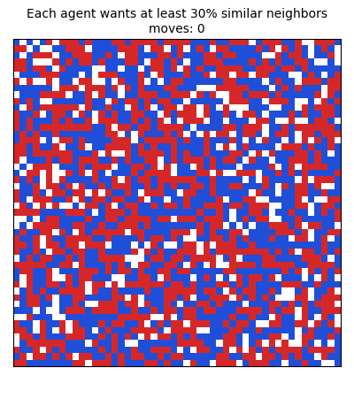
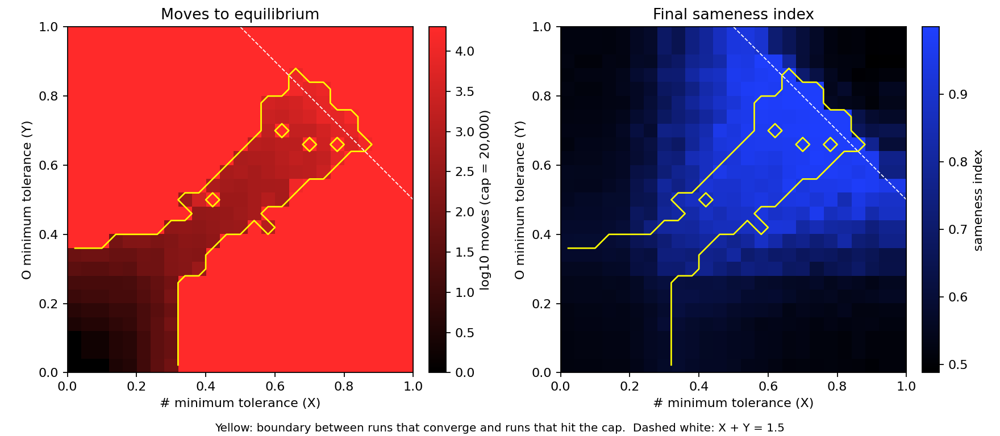
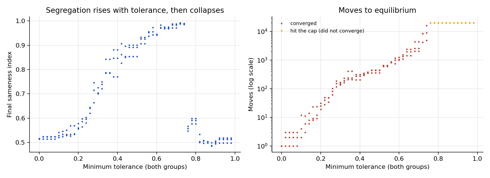
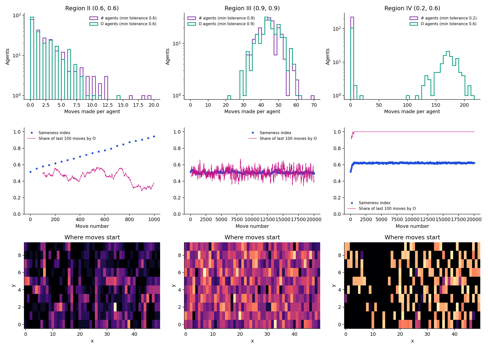

# Schelling's Segregation Model: A Numerical Map of Tolerance and Tipping Points

Maggie Deng and Avery Mangum · Math 123A final project, December 2025
📄 [Slides](docs/Schelling_numerical_analysis_slides.pdf)

<p align="center">
  
  
</p>
<p align="center"><sub>Same starting grid. Left: every agent wants at least 30% of its neighbors to be like it. Right: 70%.</sub></p>

## The question

Schelling (1971) showed that **mild individual preferences can produce extreme collective segregation**: agents who would happily live in a mixed neighborhood still end up sorted. The animations show this. Even a 30% preference visibly clusters the grid.

Most treatments look at one tolerance level shared by everyone. We asked how the outcome depends on the parameters jointly, and in particular **what happens when the two groups have different tolerances**. We also tested two assumptions we started with:

1. The system fails to converge once the two groups' tolerances sum to more than 1.
2. Equal tolerances for both groups is the representative case.

**Both turned out to be false.**

## The model

Agents of two groups (`#` and `O`) live on a 50 × 10 grid with 10% empty cells. Each agent looks at its 12 nearest cells and computes the share of occupied neighbors that belong to its own group. If that share is below its **minimum tolerance**, the agent is unhappy. Note that "minimum tolerance" means the minimum share of similar neighbors it requires, so a higher value means a *less* tolerant agent.

At each step, one unhappy agent, chosen at random, moves to a random empty cell. A run ends when everyone is satisfied, or after 20,000 moves.

We measure two outputs:
- **Moves to equilibrium:** how long it takes to settle.
- **Sameness index:** the average share of same-group neighbors. It is about 0.5 when the grid is mixed and approaches 1 when fully segregated.

We fix group sizes (45% each) and vary the two groups' minimum tolerances, **X** for `#` and **Y** for `O`, independently from 0 to 1.

## Findings

### Four distinct regimes

<p align="center"></p>

| Region | Where | Behavior |
|---|---|---|
| **I** | Both tolerances below about 1/3 | Converges in a few hundred moves or fewer; little segregation |
| **II** | Diagonal band, up to X + Y = 1.5 | Converges, but the number of moves grows **exponentially**; strong segregation (sameness 0.9+) |
| **III** | Above X + Y = 1.5 | **Never converges**: agents shuffle at random everywhere, and no segregation forms |
| **IV** | Corners with unequal tolerances | **Never converges for the more demanding group**, while the other group settles at once; segregation is partial and strongest near the diagonal band |

The convergence boundary sits at **X + Y = 1.5, not 1** (assumption 1 is false). Unequal tolerances behave qualitatively differently from equal ones (assumption 2 is false).

### A sharp tipping point

<p align="center"></p>

With equal tolerances, moves to equilibrium rise log-linearly, from about 1 to over 10,000. Then the system tips:
- at 0.75, all 6 seeds converge;
- at 0.76, none do.

Past the tipping point, segregation **collapses** back to about 0.5, because nobody can be satisfied and agents just keep shuffling.

### Why the regions behave differently

<p align="center"></p>

Counting moves per agent shows the mechanism:
- **Converging (II):** most agents move a few times and stop, giving a heavy-tailed distribution.
- **Never converging (III):** every agent keeps moving, giving a bell-shaped distribution. Moves happen everywhere on the grid, and sameness never rises.
- **Mixed (IV):** the tolerant group settles almost immediately. The demanding group splits: some agents settle, while the rest keep moving indefinitely in a few local hot spots, so overall sameness stops changing.

### Boundaries come from integer neighbor counts

The slides found that the boundary of Region I appears in two stages, at max(X, Y) ≈ 0.333 and ≈ 0.365. A finer sweep (Y = 0.1, 5 seeds per point) locates both steps exactly:

| X | 0.333 | 0.334 | … | 0.363 | 0.364 |
|---|---:|---:|---|---:|---:|
| Share of runs that never converge | 0.2 | **0.8** | … | 0.8 | **1.0** |

These are **4/12 and 4/11**. An agent's satisfaction depends on an integer count of similar neighbors, so it can only change when the tolerance crosses a fraction k/n. Most agents have 12 neighbors, while agents near the edge of the grid have 11. The diagonal tipping point, 0.75 = 9/12, has the same origin.

## A bug fix, and what it changed

While restructuring the code, I found a bug in how the original tracked unhappy agents. After each move, it re-checked only the 3 × 3 box around the agent's *new* cell. It missed two groups:
- the neighbors of the cell the agent *left*;
- cells two steps away, which the 12-cell neighborhood includes.

As a result, a run could report convergence while some agents were still unhappy. At tolerance 0.3, for example, "converged" runs ended with 11 to 18 unhappy agents.

The fix re-checks every affected agent. A test confirms the cached list always matches a brute-force recount. The original behavior remains available as `legacy_cache=True`, which reproduces the original code exactly.

**What changed.**
- **The qualitative picture holds:** all four regions, the X + Y = 1.5 boundary and the 0.75 tipping point survive the fix.
- **The convergence boundaries are sharper.** Between 4/12 and 4/11, for example, 80% of runs truly fail to converge, versus 20% under the original code.
- **Sameness at low tolerances is higher**, e.g. 0.71 rather than 0.64 at tolerance 0.3, because agents that were wrongly considered satisfied now keep moving.

The figures in this README use the fixed model. The slides used the original.

## Repository structure

```
├── schelling/              # the model: Cell, Grid, Model, neighborhoods
├── experiments/
│   ├── diagonal_sweep.py   # equal tolerances: sameness and moves vs tolerance
│   ├── tolerance_map.py    # full X–Y cross-section (the four regions)
│   ├── agent_dynamics.py   # per-agent moves, sameness over time, movement heatmaps
│   └── animate.py          # the GIFs above
├── figures/                # generated figures and animations
├── results/                # saved simulation output
├── tests/test_model.py     # correctness tests (incl. exact match with the original code)
├── legacy/                 # the original code, kept for provenance
└── docs/                   # project slides
```

## Usage

```python
from schelling import Model, EXTENDED_12, constant_tolerance

m = Model(50, 10, ["#", "O"], [0.45, 0.45],
          [constant_tolerance(0.4), constant_tolerance(0.6)],   # X = 0.4, Y = 0.6
          EXTENDED_12, seed=0)
iterations, converged, sameness_before, sameness_after = m.run(20_000, record=True)
print(m.grid.visualize())
```

Agents can also be heterogeneous within a group. A tolerance function receives each agent's quantile within its group (0 to 1) and returns its (min, max) band.

Reproduce the figures:

```bash
pip install -r requirements.txt
python experiments/diagonal_sweep.py
python experiments/tolerance_map.py --step 0.04 --workers 4   # about 10 min on one core at this resolution
python experiments/agent_dynamics.py
python experiments/animate.py
python -m pytest tests
```

## Open questions

- The boundary between Regions II and IV is fuzzy, and we have no closed-form characterization of it.
- How do the regions move with vacancy rate, grid size and neighborhood shape? This study is a 2-D slice of a 6-parameter space.
- The tolerance map uses one seed per point at a coarse resolution; more seeds would sharpen the region boundaries.

## References

- Schelling, T. C. (1971). Dynamic models of segregation. *Journal of Mathematical Sociology*, 1(2), 143–186.
- Clark, W. A. V. (1991). Residential preferences and neighborhood racial segregation: A test of the Schelling segregation model. *Demography*, 28(1), 1–19.
- McCown, F. (2014). Schelling's model of segregation. Nifty Assignments, Stanford. <http://nifty.stanford.edu/2014/mccown-schelling-model-segregation/>
